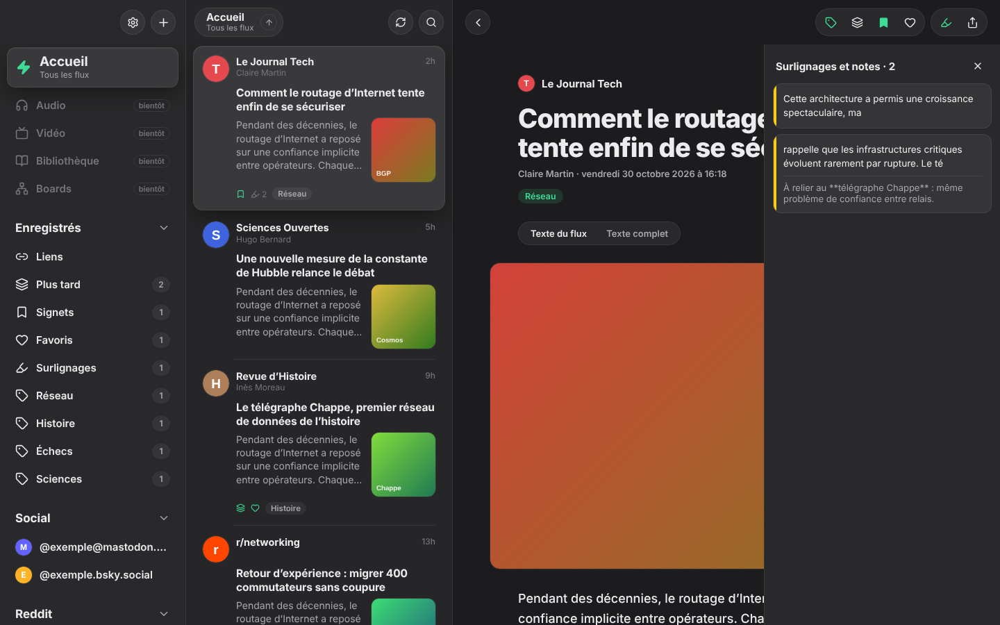
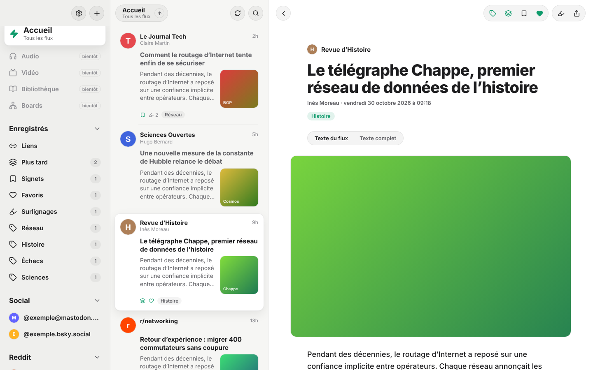
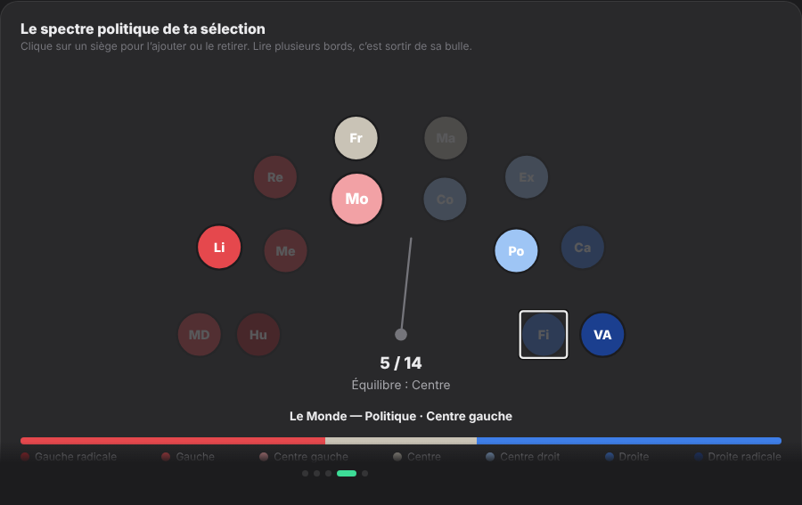
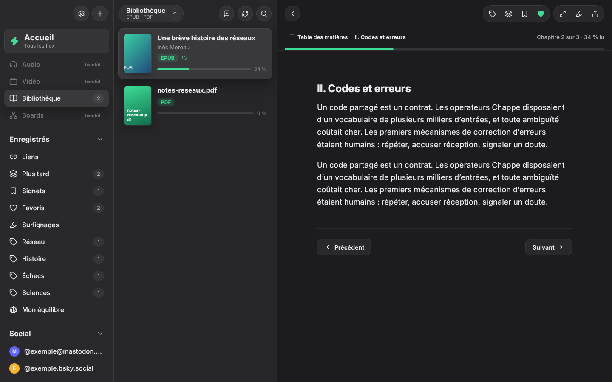
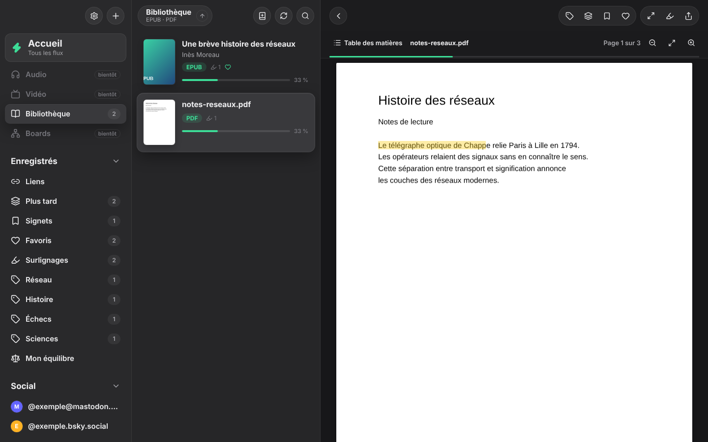

# Learn

**Lire, surligner, réfléchir.** Learn réunit tes flux RSS, Reddit, Mastodon, Bluesky, forums, articles web, livres EPUB et PDF dans un lecteur pensé pour la recherche : surlignages, notes en Markdown, export vers Obsidian.

**[⬇ Télécharger la dernière version](https://github.com/ByteOneDev/learn-reader/releases/latest)** (Mac, Windows, Linux)

Direction graphique inspirée de [Reeder](https://reederapp.com) (2024), avec sa propre identité.



| Thème clair | Hémicycle des médias au premier lancement |
|---|---|
|  |  |
| Livre EPUB | PDF surligné |
|  |  |

## Nouveautés de la v0.3 : synchronisation avec Obsidian

Active **Réglages → Obsidian → Synchroniser automatiquement**. Ensuite :

- **Learn → Obsidian** : chaque surlignage, note, couleur ou tag modifié dans Learn met à jour le fichier du document dans ton coffre, quelques secondes après.
- **Obsidian → Learn** : Learn surveille le dossier `Learn/` du coffre. Modifie une note sous un passage, change `color=yellow` en `color=pink`, supprime un passage ou change les tags du frontmatter : Learn applique le changement.
- **Rien ne se perd** : si une même note a été modifiée des deux côtés, les deux versions sont gardées. Un passage modifié dans Learn n'est jamais supprimé parce qu'il a disparu du fichier. Supprimer ou renommer le fichier ne supprime rien dans Learn, et un fichier renommé reste suivi.
- Au démarrage, Learn rattrape ce que tu as changé dans Obsidian pendant qu'il était fermé.
- Ce que tu écris sous la ligne `learn:end` reste à toi : Learn n'y touche jamais.

Le texte cité d'un passage ne se modifie pas depuis Obsidian, puisqu'il reproduit le livre ou l'article d'origine.

## Nouveautés de la v0.2

- **Bibliothèque EPUB et PDF** : import par le bouton « + », par glisser-déposer n'importe où dans la fenêtre, ou depuis la vue Bibliothèque. Couverture, titre et auteur détectés automatiquement (première page pour les PDF).
- **Lecteur EPUB** dans la typographie de Learn : table des matières, chapitres précédent/suivant (← →), renvois internes, reprise exacte de la lecture.
- **Lecteur PDF** (pdf.js) : pages rendues à la demande, zoom (⌘/Ctrl +/−), plan du document, texte sélectionnable.
- **Surlignages et notes dans les livres**, par chapitre ou par page, avec saut direct depuis le panneau. L'export Obsidian les regroupe par chapitre ou par page.
- **Progression de lecture** sur chaque livre, **mode lecture** (`z`) qui masque les colonnes.
- **Mon équilibre** : l'hémicycle rempli par ce que tu as réellement lu sur 7, 30 ou 90 jours (gauche / centre / droite), et le **propriétaire** des médias quand il est connu.

## Ce que fait la v0.1

- **Toutes tes sources dans une timeline** : RSS, Atom, JSON Feed, Reddit (`r/linux`), Mastodon (`@compte@instance`), Bluesky (`@pseudo.bsky.social`), forums (Hacker News, Lobsters, Lemmy, Discourse, LinuxFr…), YouTube (flux de chaîne). X/Twitter via une passerelle RSS que tu fournis (RSSHub, rss.app…), à régler dans les Réglages.
- **Premier lancement guidé** : langue (FR/EN), thèmes d'intérêt, puis un catalogue de ~140 médias, subreddits et comptes, pré-cochés. Import OPML pour récupérer tes abonnements Reeder.
- **Hémicycle politique** : les médias politiques sont placés sur un demi-cercle, de la gauche radicale à la droite radicale, pour voir d'un coup d'œil si ta sélection penche d'un côté. Le placement est **indicatif** et le dit.
- **Mode lecture** : bascule « Texte du flux / Texte complet » (extraction avec Mozilla Readability).
- **Surlignages en 5 couleurs, notes en Markdown**, panneau récapitulatif, réancrage automatique si le texte bouge.
- **Plus tard, Signets, Favoris, Tags, Liens à lire** (n'importe quelle page web).
- **Export Obsidian** : un fichier Markdown par document, avec frontmatter, identifiants de bloc `^h-…` et métadonnées cachées. Ce que tu écris sous le repère de fin est conservé à chaque réexport.
- **Clavier** : `j`/`k` naviguer, `l` plus tard, `b` signet, `f` favori, `m` lu/non lu, `o` navigateur, `h` surlignages, `r` actualiser, `/` rechercher, `[` barre latérale, `Échap` fermer.
- **Thèmes** sombre / clair / système, police avec ou sans empattement, taille réglable. Compteurs de non-lus désactivés par défaut (comme le nouveau Reeder), activables.

## Installer

Télécharge l'installeur de ton système sur la page **[Releases](https://github.com/ByteOneDev/learn-reader/releases/latest)** :

| Système | Fichier |
|---|---|
| macOS (Apple Silicon et Intel) | `Learn-x.y.z-arm64.dmg` / `Learn-x.y.z.dmg` |
| Windows | `Learn Setup x.y.z.exe` |
| Linux | `Learn-x.y.z.AppImage` ou `.deb` |

Les builds ne sont **pas encore signés** par un certificat officiel. Sur macOS, si l'app est dite « endommagée », lance une fois `xattr -cr /Applications/Learn.app` dans le Terminal. Sur Windows : *Informations complémentaires → Exécuter quand même*.

## Développer

Prérequis : Node.js 22.

```bash
npm install
```

```bash
npm run dev        # l'app Electron avec rechargement à chaud
```

```bash
npm run web        # l'interface seule dans un navigateur, sur une API simulée (http://localhost:5199)
```

```bash
npm test           # tests unitaires et d'intégration (Vitest)
```

```bash
npm run typecheck && npm run build
```

```bash
npm run dist       # installeur pour le système courant, dans release/
```

Pour publier une version : incrémenter `version` dans `package.json` et pousser sur `main`. Le workflow **Build desktop apps** construit les installeurs Mac, Windows et Linux et publie la release `vX.Y.Z` correspondante.

## Architecture

```
src/
  shared/      Modèle de données, ancrage des surlignages, catalogue de médias (JSON)
  main/        Processus principal : base SQLite, flux, extraction, export, IPC
    core.ts    Logique métier sans dépendance à Electron (testée avec Node seul)
    db.ts      SQLite en WebAssembly (sql.js) : aucun module natif à recompiler
    feeds/     Résolution des adresses, téléchargement, analyse RSS/Atom/RDF/JSON Feed
    books/     Lecture des EPUB (zip, OPF, table des matières, chapitres)
    export/    Génération du Markdown Obsidian
    sync/      Synchronisation bidirectionnelle avec Obsidian (fusion à trois voies)
  preload/     Pont minimal et typé entre l'interface et le système
  renderer/    Interface React (Zustand, Framer Motion, Lucide, pdf.js)
tests/         Vitest : analyse, résolution, OPML, Markdown, ancrage, catalogue, intégration HTTP
```

Le modèle (SQLite, surlignages façon W3C Web Annotation, Markdown Obsidian) ne dépend pas d'Electron : la future app native pourra rouvrir la même bibliothèque.

### Sécurité

Le contenu des flux vient d'Internet et doit être traité comme hostile :

- fenêtre en `sandbox`, `contextIsolation`, sans `nodeIntegration` ; l'interface ne parle au système que par une liste fermée de méthodes IPC, et seule la fenêtre de l'app peut les appeler ;
- HTML des articles nettoyé par DOMPurify (pas de scripts, iframes, formulaires, styles ni SVG) ;
- Content-Security-Policy stricte en production (aucun script distant ou inline) ;
- liens ouverts dans le navigateur, navigation interne bloquée, permissions (caméra, micro…) refusées ;
- icônes des sites mises en cache localement (pas de service tiers), SVG refusés.

## Le catalogue de médias

[`scripts/gen-catalog.mjs`](scripts/gen-catalog.mjs) génère [`src/shared/catalog.json`](src/shared/catalog.json). Pour ajouter un média : une ligne dans le script, puis `node scripts/gen-catalog.mjs`.

Les adresses de flux changent souvent : le workflow **Feeds health** les vérifie chaque lundi (et `npm run check-feeds` en local) et liste celles qui ne répondent plus.

L'orientation politique (−3 à +3) est une estimation de Learn à partir des lignes éditoriales publiques. C'est un repère pour diversifier ses lectures, pas un verdict. Pour l'anglais, compare avec [AllSides](https://www.allsides.com/media-bias/ratings) ou [Ad Fontes Media](https://adfontesmedia.com).

## Feuille de route

- ~~**v0.2** : EPUB et PDF avec surlignage ; bilan de lecture dans l'hémicycle ; propriétaires des médias~~ ✓
- ~~**v0.3** : synchronisation bidirectionnelle avec Obsidian (surveillance du coffre)~~ ✓
- **v0.4** : Boards, des mind maps et canvas où glisser surlignages et extraits, export JSON Canvas (Obsidian Canvas)
- **v0.5** : Notion (export puis synchro)
- **Ensuite** : podcasts, vidéos YouTube, extension Obsidian, app native

## Licence

MIT
